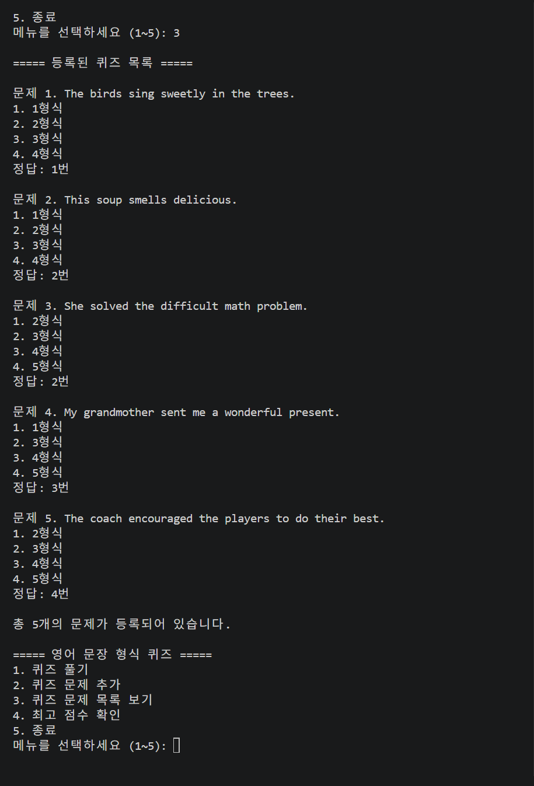
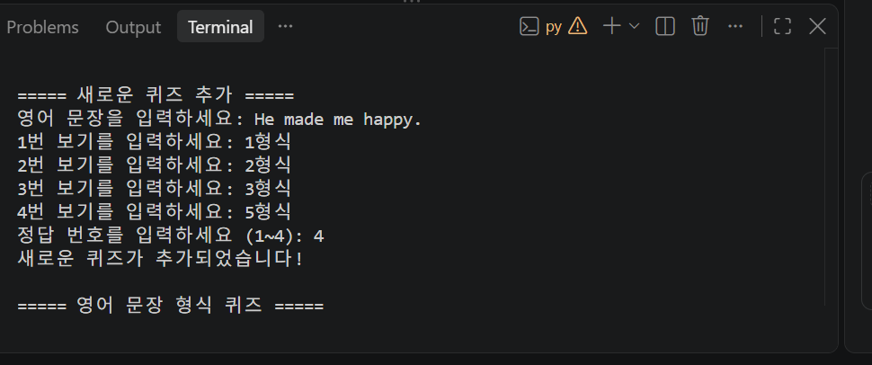
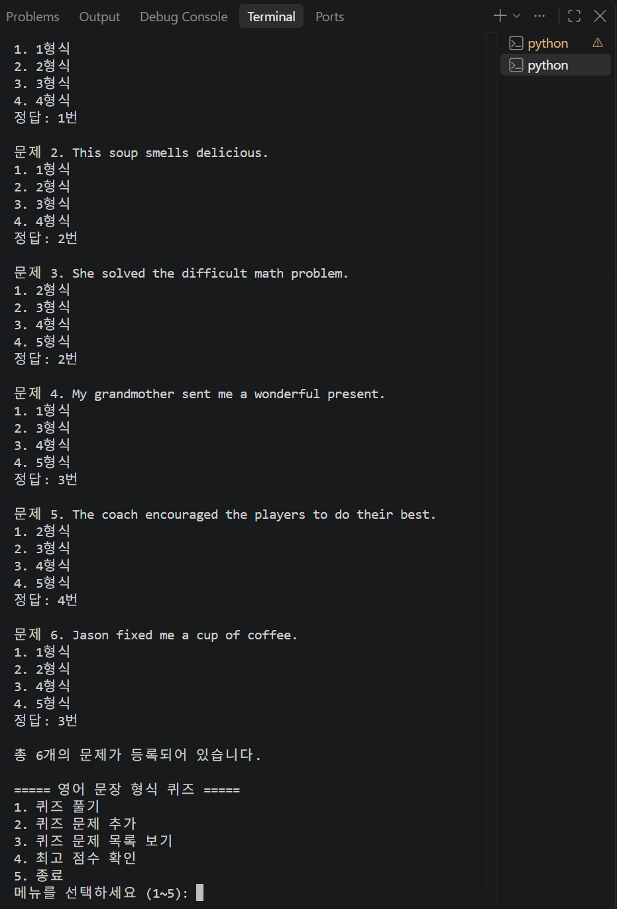
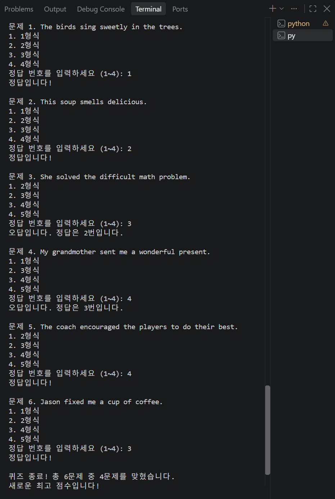
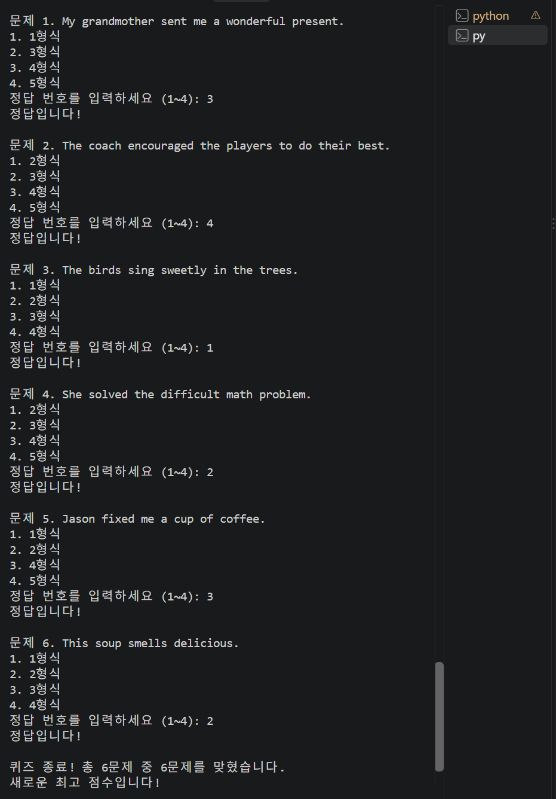
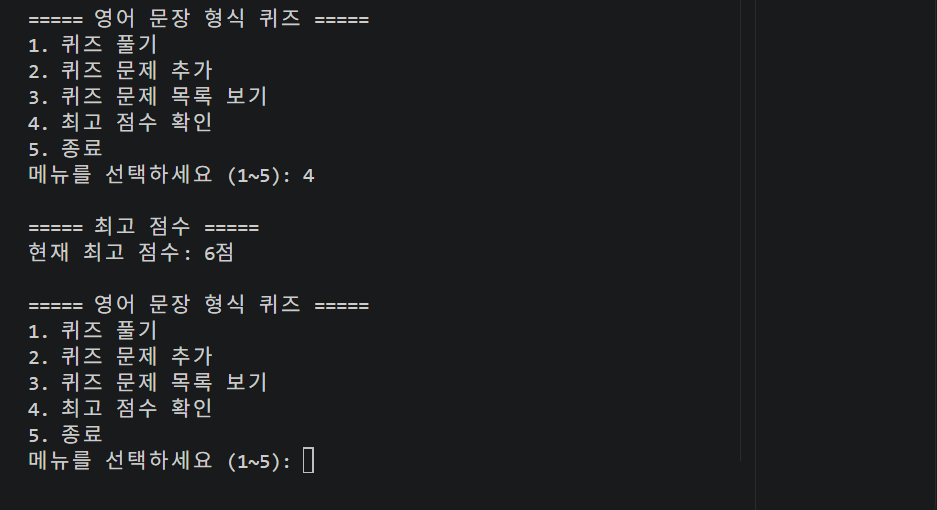
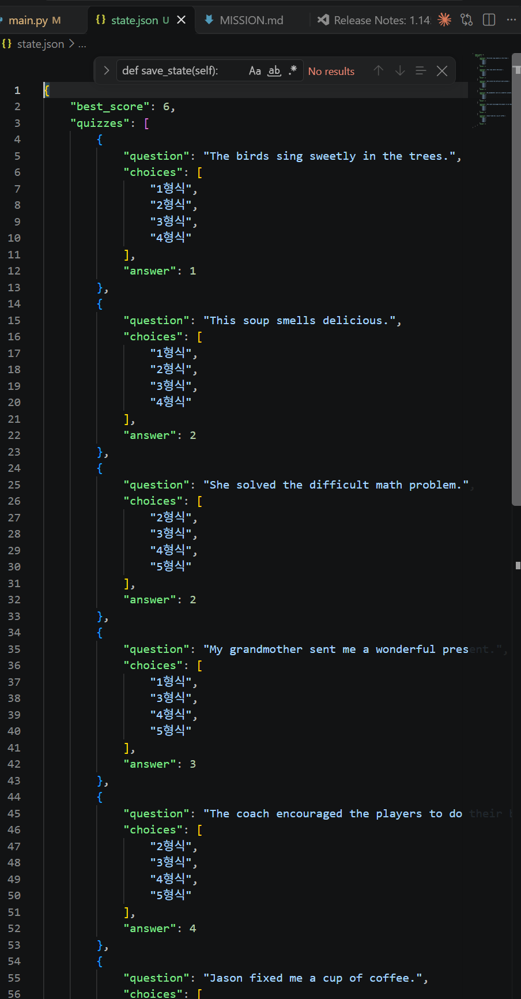
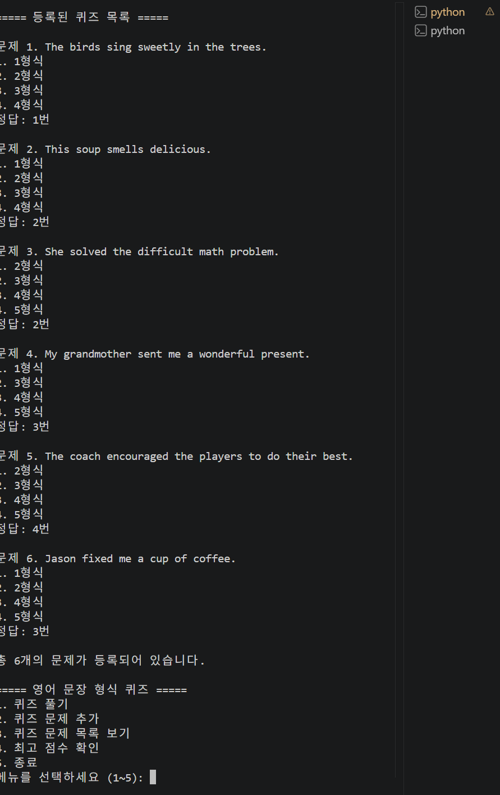
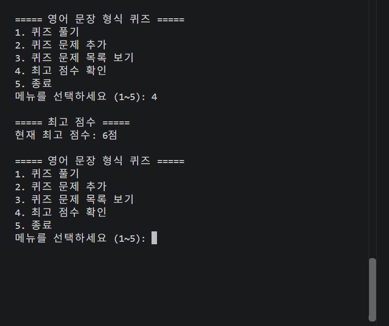
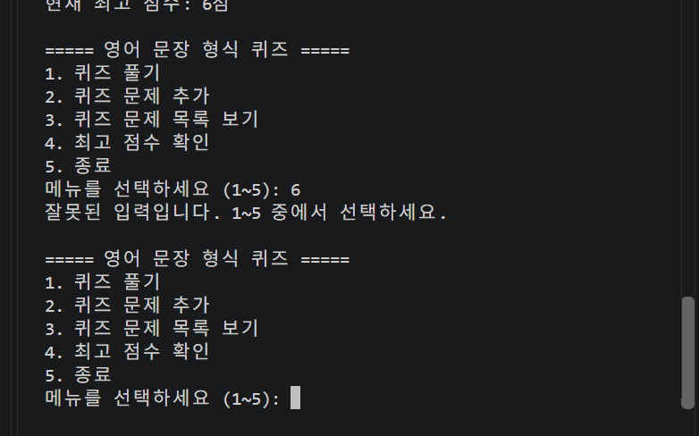

# E1-2 컴퓨터에게 명령 내리는 말(파이썬) - 나만의 퀴즈 게임

> **코디세이(Codyssey) E1-2 미션**: 파이썬 기초 문법, 객체 지향 프로그래밍(OOP), 파일 기반 데이터 영속성(`state.json`), Git 협업 워크플로우를 직접 구현하고 검증하는 콘솔 애플리케이션 프로젝트입니다.
> 
> 💡 **VS Code 실전 워크북**: 단계별 코드 복사 및 실습 가이드는 [GUIDE.md](./GUIDE.md)를 참고하세요.

---

## 1. 프로젝트 개요

- **프로젝트 명**: 나만의 파이썬 콘솔 퀴즈 게임 (`E1-2-python-basics`)
- **개발 언어**: Python 3.10+ (외부 패키지 없이 표준 라이브러리 `json`, `random`만 사용)
- **핵심 목표**:
  1. **객체 지향 설계 (OOP)**: `Quiz`, `QuizGame` 클래스 분리를 통한 역할과 책임 분담
  2. **견고한 예외 처리**: 공백 입력 방지, 범위 밖 숫자 재입력 유도, `Ctrl+C`(`KeyboardInterrupt`), `EOFError`, 손상된 JSON 파일 안전 자동 복구
  3. **데이터 영속성**: 프로그램 종료 후에도 영구 유지되는 `state.json` 파일 저장 및 불러오기 (`best_score`, `quizzes`)
  4. **Git 워크플로우 실습**: 10개 이상의 기능별 커밋 기록, 브랜치 작업, 원격 푸시 및 복제 검증
  5. **보너스 과제 구현**: `random.sample`을 활용한 문제 무작위(랜덤) 출제 기능 완비

---

## 2. 퀴즈 주제 및 선정 이유

- **선정 주제**: **영어 문장의 형식 (1형식 ~ 5형식 문법 퀴즈)**
- **선정 이유**:
  - 현재 중학교 학생들이 영어 문장의 5가지 기본 형식(1형식~5형식) 학습을 모두 마친 상태로, 학생들이 문장 구조와 필수 문장 성분(주어, 동사, 목적어, 보어, 수식어)을 얼마나 정확하게 구분하고 이해하고 있는지 학습 성취도와 이해 수준을 점검하기 위해 선정하였습니다.
  - 1형식부터 5형식까지 각 문장 형식별 핵심 대표 예문과 4지선다 선택지, 정답 번호를 객체 지향(OOP) 모델링과 JSON 영속 데이터 실습에 최적화하여 구현하였습니다.

---

## 3. 종합 수행 체크리스트

### [필수 1] 개발 환경 및 코드 구조 (OOP)
- [x] Python 3.10 이상 사용 및 외부 라이브러리 배제 (표준 모듈 `json`, `random` 활용)
- [x] `Quiz` 클래스 정의 (속성: `question`, `choices`, `answer`)
- [x] `QuizGame` 클래스 정의 (속성: `quizzes`, `score`, `best_score` / 메서드: `show_menu`, `play_quiz`, `add_quiz`, `show_quizzes`, `show_best_score`, `save_state`, `load_state`)
- [x] 기능별 메서드 분리 및 단일 책임 원칙(SRP) 준수

### [필수 2] 핵심 기능 및 데이터 영속성
- [x] 메뉴 인터페이스: 1. 퀴즈 풀기, 2. 퀴즈 문제 추가, 3. 퀴즈 문제 목록 보기, 4. 최고 점수 확인, 5. 종료
- [x] 기본 퀴즈 데이터 5문항 내장 (1형식~5형식 대표 예문)
- [x] 퀴즈 풀기 기능: 문제 무작위(랜덤) 출제, 정답/오답 즉시 피드백, 최종 결과 출력 및 최고 점수 자동 갱신
- [x] 퀴즈 추가 기능: 영어 문장, 1~4번 선택지, 정답 번호(1~4) 입력받아 신규 등록 및 파일 자동 저장
- [x] 퀴즈 목록 조회: 등록된 전체 문제와 선택지, 정답 번호 확인
- [x] 최고 점수 확인: 역대 최고 득점 점수 표시
- [x] `state.json` 영속 저장: UTF-8 인코딩으로 저장/로드, 파일 부재 시 기본 퀴즈로 시작, 파일 손상 시 `try-except` 자동 복구

### [필수 3] 입력 검증 및 견고한 예외 처리
- [x] 입력 앞뒤 공백 자동 제거 (`strip()`)
- [x] 메뉴 선택 시 1~5 이외의 잘못된 입력에 대한 안내 및 재입력 유도
- [x] 퀴즈 풀기 정답 입력 시 1~4 이외의 잘못된 입력에 대한 안내 및 재입력 유도
- [x] 문제 및 보기 입력 시 빈 값(공백) 방지 루프 처리
- [x] `Ctrl+C`(`KeyboardInterrupt`) 또는 `EOFError` 발생 시 비정상 종료 방지 및 `finally` 블록을 통한 안전 저장 후 종료

### [필수 4] Git 워크플로우 실습
- [x] GitHub 원격 저장소 생성 (`E1-2-python-basics`) 및 로컬 연동
- [x] 표준 `.gitignore`, `README.md`, `GUIDE.md` 구성
- [x] 기능 단위의 의미 있는 커밋 10개 이상 작성 (`Feat:`, `Chore:`, `Docs:`)
- [x] 브랜치 생성 및 병합 실습 (`checkout`, `merge`) 완료
- [x] Git 기초 필수 7대 명령어(`init`, `add`, `commit`, `push`, `pull`, `checkout`, `clone`) 100% 실습 완료
- [x] 미션 13번 저장소 복제(`clone`) 및 동기화(`pull`) 실습 완료

### [보너스 과제]
- [x] **보너스 과제. 랜덤 출제 기능 완비**: `random.sample(self.quizzes, len(self.quizzes))`를 활용하여 퀴즈 출제 순서를 무작위로 셔플하여 출제

---

## 4. 파일 및 디렉터리 구조

```text
E1-2-python-basics/
├── MISSION.md              # 코디세이 E1-2 미션 요구사항 전문
├── README.md               # 프로젝트 안내 및 최종 수행 보고서
├── GUIDE.md                # VS Code 단계별 실습 가이드 워크북
├── .gitignore              # Python 캐시 및 임시 파일 제외 설정
├── main.py                 # 퀴즈 게임 메인 실행 파일 (Quiz, QuizGame 클래스 및 CLI)
├── state.json              # 퀴즈 목록 및 최고 점수 영속 저장 파일
└── docs/
    └── screenshots/        # 과제 수행 및 기능 검증 스크린샷 (총 10종)
        ├── 01_quiz_list.png
        ├── 02_quiz_add.png
        ├── 03_quiz_list_updated.png
        ├── 04_quiz_result.png
        ├── 05_random_quiz.png
        ├── 06_best_score.png
        ├── 07_json_saved.png
        ├── 08_quiz_reload.png
        ├── 09_best_score_reload.png
        └── 10_invalid_input.png
```

---

## 5. 데이터 파일 스키마 (`state.json`)

프로젝트 루트의 `state.json` 파일은 UTF-8 인코딩으로 영구 저장되며, 최고 점수와 전체 퀴즈 목록 데이터를 다음과 같은 구조로 관리합니다:

```json
{
    "best_score": 6,
    "quizzes": [
        {
            "question": "The birds sing sweetly in the trees.",
            "choices": [
                "1형식",
                "2형식",
                "3형식",
                "4형식"
            ],
            "answer": 1
        },
        {
            "question": "This soup smells delicious.",
            "choices": [
                "1형식",
                "2형식",
                "3형식",
                "4형식"
            ],
            "answer": 2
        },
        {
            "question": "She solved the difficult math problem.",
            "choices": [
                "2형식",
                "3형식",
                "4형식",
                "5형식"
            ],
            "answer": 2
        },
        {
            "question": "My grandmother sent me a wonderful present.",
            "choices": [
                "1형식",
                "3형식",
                "4형식",
                "5형식"
            ],
            "answer": 3
        },
        {
            "question": "The coach encouraged the players to do their best.",
            "choices": [
                "2형식",
                "3형식",
                "4형식",
                "5형식"
            ],
            "answer": 4
        },
        {
            "question": "He fixed me a cup of coffee.",
            "choices": [
                "1형식",
                "2형식",
                "4형식",
                "5형식"
            ],
            "answer": 3
        }
    ]
}
```

---

## 6. 실행 방법

### 1) 실행 환경
- Python 3.10 이상 설치 필요
- 터미널(Command Prompt, PowerShell, Bash, WSL) 및 VS Code 내장 터미널 지원

### 2) 실행 명령어
```bash
# 저장소 복제 (최초 1회)
git clone https://github.com/PuffyCripsy/E1-2-python-basics.git
cd E1-2-python-basics

# 프로그램 실행
python main.py
```

---

## 7. 주요 기능 시연 및 메뉴 가이드

| 메뉴 번호 | 기능 | 설명 및 동작 |
| :---: | :--- | :--- |
| **1** | **퀴즈 풀기** | 등록된 전체 문제를 무작위(랜덤) 순서로 출제하고 정답/오답 즉시 판정, 최종 점수 산출 및 최고 점수 자동 갱신 |
| **2** | **퀴즈 문제 추가** | 새 영어 문장, 1~4번 보기, 정답 번호를 입력받아 유효성 검증 후 퀴즈 목록에 추가 및 `state.json` 자동 저장 |
| **3** | **퀴즈 문제 목록 보기** | 현재 등록된 전체 퀴즈 문제와 4개 선택지, 정답 번호를 번호순으로 상세 출력 |
| **4** | **최고 점수 확인** | 현재까지 기록된 역대 최고 득점 점수(`best_score`) 단독 조회 |
| **5** | **종료** | 게임 상태(`quizzes`, `best_score`)를 `state.json`에 안전 저장 후 프로그램 정상 종료 (`Ctrl+C` 입력 시에도 안전 저장) |

---

## 8. 게임 구현 및 동작 검증 스크린샷 (10종)

프로그램 실행 및 구현 순서에 따른 실제 동작 검증 스크린샷 10종입니다.

### 1) 기본 퀴즈 목록 조회 (메뉴 3번)
프로그램을 최초 실행한 후 메뉴 3번(`퀴즈 문제 목록 보기`)을 선택하여, 코드에 기본 내장된 1형식부터 5형식까지의 대표 예문 5문항과 선택지, 정답 번호가 정상적으로 출력되는 화면입니다.



---

### 2) 새로운 퀴즈 문제 추가 (메뉴 2번)
메뉴 2번(`퀴즈 문제 추가`)을 실행하여 새로운 4형식 문장 예문(`He fixed me a cup of coffee.`)과 `1~4`번 보기, 정답 번호(`3`)를 입력하여 새 퀴즈를 등록하는 화면입니다.



---

### 3) 추가된 퀴즈가 반영된 목록 확인 (메뉴 3번)
새로운 퀴즈 등록 후 메뉴 3번을 다시 조회하여, 기존 5문제에서 신규 추가된 문제(`He fixed me a cup of coffee.`)까지 포함해 총 6문제로 정상 갱신된 전체 목록을 확인하는 화면입니다.



---

### 4) 퀴즈 풀기 진행 및 최종 점수 결과 (메뉴 1번)
메뉴 1번(`퀴즈 풀기`)을 선택하여 등록된 문제들을 차례대로 풀이하고, 문항별 정답/오답 판정 및 해설 안내와 함께 최종 결과(총 6문제 중 4문제 정답)와 새로운 최고 점수 달성을 확인하는 화면입니다.



---

### 5) [보너스 과제] 퀴즈 무작위(랜덤) 출제 검증
`random.sample`을 적용하여 퀴즈 풀기 진행 시 1번 문항부터 고정된 순서로 나오지 않고 문제 순서가 무작위로 셔플되어 출제되는 보너스 기능 동작 화면입니다 (총 6문제 중 6문제 만점 달성).



---

### 6) 최고 점수 확인 (메뉴 4번)
메뉴 4번(`최고 점수 확인`)을 선택하여 직전 퀴즈 풀이에서 갱신된 최고 점수가 "현재 최고 점수: 6점"으로 정확하게 조회되는 화면입니다.



---

### 7) state.json 파일 영속 저장 확인
VS Code 편집기에서 `state.json` 파일을 열어 최고 점수(`best_score: 6`)와 추가된 퀴즈를 포함한 6개의 문제 데이터가 JSON 포맷으로 누락 없이 안전하게 영구 저장된 구조를 확인하는 화면입니다.



---

### 8) 프로그램 재실행 후 퀴즈 목록 자동 복원 검증
프로그램을 완전히 종료한 후 터미널에서 다시 실행(`python main.py`)했을 때, `load_state()`가 동작하여 `state.json` 파일에 저장되어 있던 6개의 퀴즈 목록을 완벽하게 복원해 출력하는 데이터 영속성 검증 화면입니다.



---

### 9) 프로그램 재실행 후 최고 점수 복원 검증
프로그램 재실행 후 메뉴 4번(`최고 점수 확인`)을 조회했을 때, 이전 실행 세션에서 기록했던 최고 점수(6점)가 세션 종료 후에도 휘발되지 않고 그대로 유지되는 화면입니다.



---

### 10) 메뉴 및 입력 예외 처리 검증
메뉴 선택 시 `1~5` 범위를 벗어난 번호(예: `6`)를 입력했을 때 `잘못된 입력입니다. 1~5 중에서 선택하세요.`라는 명확한 오류 안내를 출력하고, 프로그램이 비정상 종료되지 않고 안전하게 재입력을 유도하는 견고한 예외 처리 검증 화면입니다.



---

## 9. Git 워크플로우 실습 기록

### 1) Git 기초 필수 7대 명령어 수행 내역
미션 제약 사항에 명시된 Git 기초 7종 명령어를 프로젝트 전 과정에 걸쳐 각각 1회 이상 정상 수행하였습니다:

| 명령어 | 실제 수행 단계 및 용도 | 실습 내역 |
| :---: | :--- | :--- |
| **`git init`** | 로컬 작업 공간 초기화 | 프로젝트 디렉터리 생성 및 로컬 Git 저장소 초기화 |
| **`git clone`** | 원격 저장소 복제 | GitHub 원격 저장소를 로컬 컴퓨터로 복제 및 미션 13번 복제 실습 |
| **`git checkout`** | 브랜치 생성 및 전환 | `feature/quiz-play` 기능 브랜치 생성 및 이동 |
| **`git add`** | 스테이징 영역 등록 | 작성한 코드 및 README, 스크린샷 변경 파일 추적 |
| **`git commit`** | 의미 있는 변경 이력 기록 | 기능별 15개 이상의 구조화된 커밋 메시지 작성 (`Feat:`, `Docs:`, `Chore:`) |
| **`git push`** | 원격 저장소 반영 | 로컬 커밋 내역을 GitHub `main` 원격 브랜치로 발행 |
| **`git pull`** | 원격 변경사항 동기화 | 원격 저장소의 최신 가이드 및 복제본 변경사항 로컬 동기화 |

---

### 2) 브랜치 생성 및 병합 실습 (`checkout` & `merge`)
기능 개발 시 독립된 브랜치를 생성하여 작업하고, 검증 완료 후 `main` 브랜치로 병합하는 실무 워크플로우를 완벽히 수행하였습니다:

```bash
# 1. 퀴즈 풀기 기능 전용 브랜치 생성 및 이동
git checkout -b feature/quiz-play

# 2. 퀴즈 풀기 및 채점 기능 구현 후 커밋
git add main.py
git commit -m "Feat: 퀴즈 출제 및 정답 채점 기능 구현"

# 3. main 브랜치로 복귀 후 안전 병합
git checkout main
git merge feature/quiz-play

# 4. 원격 GitHub 저장소 푸시
git push origin main
```

---

### 3) 저장소 복제 및 동기화 실습 (`clone` & `pull` - 미션 13번)
미션 13번 요구사항에 따라 별도의 로컬 복제 환경을 구성하여 `clone`과 `pull` 동작을 직접 검증하였습니다:

1. **복제(`clone`)**: 별도의 테스트 디렉터리에 원격 저장소를 새로 복제
   ```bash
   git clone https://github.com/PuffyCripsy/E1-2-python-basics.git test-clone
   cd test-clone
   ```
2. **변경 및 푸시(`push`)**: 복제본에서 문서 보강 후 원격 저장소로 커밋 및 발행
   ```bash
   git add README.md
   git commit -m "Docs: Git 7대 명령어 및 clone/pull 실습 기록 갱신"
   git push origin main
   ```
3. **가져오기(`pull`)**: 기존 메인 작업 디렉터리로 복귀하여 원격 변경사항을 가져와 동기화 완료
   ```bash
   cd ../E1-2-python-basics
   git pull origin main
   ```

---

### 4) 실제 기능별 커밋 이력 및 그래프 (`git log --oneline --graph`)
프로젝트 진행 과정에서 기능 단위로 의미 있게 누적된 16개의 실전 커밋 내역입니다:

```text
* Docs: Git 7대 명령어 및 clone/pull 실습 기록 갱신 (미션 13번 완료)
* c0265fa docs: Fix strikethrough rendering issue in section 10 by escaping tildes with backticks
* a293f9a docs: Update added quiz sentence description to 'He fixed me a cup of coffee.'
* fbd761d docs: Update README to match actual main.py implementation, state.json schema, and 10 verification screenshots
* ce05613 Feat: Add JSON persistence, random quiz order, and test screenshots
* 70a1d50 Feat: Add best score tracking and display
* 593fe93 Chore: Move screenshots into docs folder
* 3c90b80 Feat: Add quiz list display functionality
* 603ec17 Feat: Add quiz creation functionality and screenshots
* b24bc55 Feat: Add main menu and exit functionality
* f690b40 Feat: 정답 입력 검증 및 점수 계산 기능 구현
* 2908f8c Feat: Quiz 클래스 및 문제 출력 기능 구현
* c2dde49 docs: Add step-by-step VS Code workbook GUIDE.md with 10-step commits, branch practice, and complete main.py reference
* 915c423 docs: Update quiz topic to English Sentence Patterns (1-5 형식) and assessment rationale
* 374d84c docs: Update README with comprehensive mission checklist, bonus tasks, and execution guide
* b07c6ab docs: Add E1-2 mission requirements, starter README, and .gitignore
```
